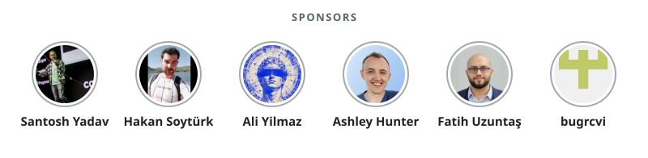
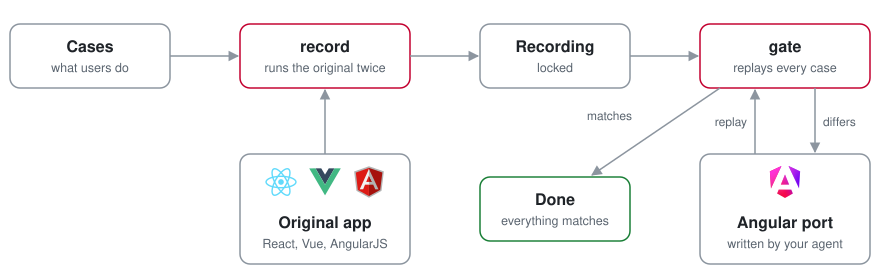

<p align="center">
  
</p>

<h1 align="center">Angular Anything</h1>

<p align="center">
<a href="https://github.com/erkamyaman/angular-anything/blob/main/LICENSE"></a>


</p>

<p align="center">
Move your app or library to Angular with agents, and prove it still behaves the same.
</p>

<p align="center">
<b>Documentation:</b> <a href="https://github.com/erkamyaman/angular-anything/blob/main/docs/reference.md">reference</a>
</p>

## Sponsors

<p align="center">
  Made in Türkiye 🇹🇷 by <a href="https://github.com/erkamyaman">erKam Yaman</a><br>
  Angular Anything is free and open source. If it helps your work, sponsoring keeps it going.
</p>

<p align="center"><sub>Your safety comes first: sponsors get a logo and a link here, nothing more. No paid recommendations and no setup guides for third-party AI API resellers, so nothing here steers your code, keys or data somewhere you didn't choose.</sub></p>

<p align="center">
  <a href="https://coderabbit.link/er-kam">
    <picture>
      <source media="(prefers-color-scheme: dark)" srcset="docs/assets/sponsors/company-dark.svg">
      
    </picture>
  </a>
</p>

<p align="center">
  <a href="https://www.atakdomain.com/">
    <picture>
      <source media="(prefers-color-scheme: dark)" srcset="docs/assets/sponsors/domain-dark.svg">
      
    </picture>
  </a>
</p>

<p align="center">
  <a href="https://github.com/sponsors/erkamyaman">
    <picture>
      <source media="(prefers-color-scheme: dark)" srcset="docs/assets/sponsors/sponsors-dark.svg">
      
    </picture>
  </a>
</p>

<p align="center">
  <a href="https://github.com/sponsors/erkamyaman"></a>
  <a href="https://buymeacoffee.com/erkamyaman"></a>
</p>

<p align="center">Sponsoring as a company, or anything else? <a href="mailto:erkamyaman35@gmail.com">erkamyaman35@gmail.com</a></p>

<p align="center">Moving an app to modern Angular? I offer consulting for Angular migrations: <a href="mailto:erkamyaman35@gmail.com">erkamyaman35@gmail.com</a></p>

## Quick start

Paste this into your coding agent:

```text
Read https://raw.githubusercontent.com/erkamyaman/angular-anything/main/llms.txt, install Angular Anything, record this app, port it to Angular, and keep fixing the port until the gate passes.
```

> [!TIP]
> **Agents:** read [llms.txt](https://github.com/erkamyaman/angular-anything/blob/main/llms.txt) for the install steps, every command and the porting workflow.

Or install it yourself (Node 24 or newer):

```sh
npm install -g angular-anything
angular-anything doctor   # prints the command that installs Chromium if it is missing
```

To try it on the sample apps, run it from a clone (needs pnpm):

```sh
git clone https://github.com/erkamyaman/angular-anything
cd angular-anything
pnpm install
pnpm exec playwright install chromium
pnpm fixtures:build
pnpm fixtures:serve
```

In a second terminal, check the Angular port of the sample app against the recording of its React original:

```sh
pnpm aa gate fixture --source react --url http://localhost:4104                # passes
pnpm aa gate fixture --source react --url 'http://localhost:4104/?bug=aria'    # a seeded bug, fails
```

## How it works

<p align="center">
  <picture>
    <source media="(prefers-color-scheme: dark)" srcset="docs/assets/how-it-works-dark.svg">
    
  </picture>
</p>

1. **Find the cases.** Your agent reads the app and writes down what users do, as short [cases](https://github.com/erkamyaman/angular-anything/blob/main/cases/fixture/add-task/case.json). You can add your own.
2. **Record** the original (React, Vue or AngularJS). `record` runs each case twice and locks what happened.
3. **Port.** Your agent rewrites the app in Angular.
4. **Gate** the port. It replays every case and fails on any difference.

**What is compared.** After each step: the accessibility tree, the DOM, computed styles, events, requests that change data, `localStorage`, the URL, the title, focus, dialogs and windows. Sizes and positions are compared when the original runs alongside. Screenshots are reported and never fail the gate.

**No backend needed to check.** Requests the original made with `fetch` or XMLHttpRequest are recorded and answered from that recording.

**Secrets.** `record` refuses to save a case in which it detects a secret (`credential`, `jwt`, `pem`, `bearer-or-basic`, `url-password`, `named-value`, `secret-field`). Detection has limits, so record against test data.

**Limits.** Early software, tested on macOS only. Read the [reference](https://github.com/erkamyaman/angular-anything/blob/main/docs/reference.md) before relying on it.

## Notes

Angular Anything is not affiliated with Angular or Google, and collects no telemetry.

## License

MIT. See [LICENSE](https://github.com/erkamyaman/angular-anything/blob/main/LICENSE).

`trials/` and parts of `recordings/` include third-party work, among it [TodoMVC](https://github.com/tastejs/todomvc) and [Sonner](https://github.com/emilkowalski/sonner) by Emil Kowalski, which `trials/sonner/angular` ports to Angular.
Each keeps its own license (todomvc-app-css is CC BY 4.0). See [THIRD_PARTY_NOTICES.md](https://github.com/erkamyaman/angular-anything/blob/main/THIRD_PARTY_NOTICES.md).
